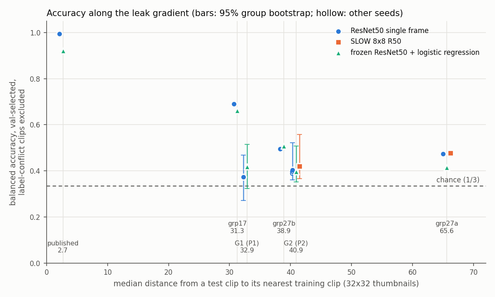

# Leak-gradient results: published split, G1 events, G2 events ∪ scenes

*Generated by `scripts/research/06c_aggregate.py` on 2026-11-08 18:59 from `outputs/research_gpu/_summary` (261 prediction files, 6 s). Do not edit by hand: rerun the script. Plan: `11_gpu_experiment_plan.md`; protocol: `10_reconstruction_qc_and_protocol.md`.*

## 0. Definitions and completeness

- **Rules.** *val-selected* = checkpoint with the best validation accuracy (validation = whole groups carved from the training folds by `06_make_protocol_roots.py`); *final* = last epoch trained. The probe is one fit, so both rules are the same model.
- **Label-conflict clips** = events 9, 11, 18 (880 clips; under P1 the whole G1 groups 34, 40, 44). Columns marked *excl* leave them out; that is the headline (plan, decision 5).
- **Majority** = share of the most frequent class in that test set (best constant predictor; its balanced accuracy is 1/3, its κ 0).
- SLOW needs 64 frames, so clips shorter than that drop out of its train, val and test sets (`n` vs `n_expected`).
- Bootstrap: groups resampled with replacement, 2,000 reps, seed 0, pooled metrics recomputed; 95% percentile interval.

Cross-fold nearest-neighbour medians (x axis of the figure):

| protocol | NN median | source |
|---|---|---|
| P0 published | 2.70 | leak_nn_by_split.csv: median d, published |
| grp17 | 31.28 | leak_nn_by_split.csv: median d, grp17 |
| P1 G1 events | 32.86 | union_groups_summary.json: G1_event cross_fold_nn.median |
| grp27b | 38.90 | leak_nn_by_split.csv: median d, grp27b |
| P2 G2 events+scenes | 40.89 | union_groups_summary.json: G2_event_scene27 cross_fold_nn.median |
| grp27a | 65.60 | leak_nn_by_split.csv: median d, grp27a |

Planned runs found: 39 of 39.

## 1. Pooled metrics (all test folds together)

| protocol | recipe | seed | rule | folds | n | acc | bal acc | macro-F1 | κ | n excl | acc excl | bal acc excl | macro-F1 excl | κ excl | majority excl |
|---|---|---|---|---|---|---|---|---|---|---|---|---|---|---|---|
| p0 | probe | 0 | val-selected | 1/1 | 771 | 0.923 | 0.923 | 0.920 | 0.883 | 678 | 0.920 | 0.921 | 0.912 | 0.876 | 0.426 |
| grp17 | probe | 0 | val-selected | 1/1 | 1540 | 0.659 | 0.636 | 0.638 | 0.473 | 1297 | 0.699 | 0.662 | 0.657 | 0.509 | 0.445 |
| p1 | probe | 0 | val-selected | 5/5 | 7701 | 0.449 | 0.441 | 0.440 | 0.169 | 6821 | 0.443 | 0.419 | 0.420 | 0.154 | 0.403 |
| p1 | r50 | 42 | final | 5/5 | 7701 | 0.382 | 0.371 | 0.363 | 0.075 | 6821 | 0.385 | 0.349 | 0.349 | 0.073 | 0.403 |
| p1 | r50 | 42 | val-selected | 5/5 | 7701 | 0.396 | 0.388 | 0.383 | 0.092 | 6821 | 0.396 | 0.373 | 0.369 | 0.091 | 0.403 |
| grp27b | probe | 0 | val-selected | 1/1 | 1730 | 0.557 | 0.501 | 0.475 | 0.301 | 1638 | 0.587 | 0.507 | 0.493 | 0.333 | 0.429 |
| p2 | probe | 0 | val-selected | 5/5 | 7701 | 0.434 | 0.412 | 0.408 | 0.129 | 6821 | 0.437 | 0.397 | 0.395 | 0.117 | 0.403 |
| p2 | r50 | 42 | final | 5/5 | 7701 | 0.399 | 0.390 | 0.384 | 0.081 | 6821 | 0.405 | 0.379 | 0.376 | 0.069 | 0.403 |
| p2 | r50 | 42 | val-selected | 5/5 | 7701 | 0.453 | 0.441 | 0.438 | 0.163 | 6821 | 0.437 | 0.405 | 0.402 | 0.120 | 0.403 |
| p2 | r50 | 43 | final | 5/5 | 7701 | 0.392 | 0.376 | 0.361 | 0.063 | 6821 | 0.402 | 0.366 | 0.358 | 0.053 | 0.403 |
| p2 | r50 | 43 | val-selected | 5/5 | 7701 | 0.419 | 0.410 | 0.396 | 0.120 | 6821 | 0.429 | 0.397 | 0.387 | 0.117 | 0.403 |
| p2 | r50 | 44 | final | 5/5 | 7701 | 0.394 | 0.379 | 0.366 | 0.067 | 6821 | 0.409 | 0.373 | 0.365 | 0.062 | 0.403 |
| p2 | r50 | 44 | val-selected | 5/5 | 7701 | 0.415 | 0.400 | 0.395 | 0.105 | 6821 | 0.423 | 0.388 | 0.386 | 0.099 | 0.403 |
| p2 | slow | 42 | final | 5/5 | 7588 | 0.402 | 0.393 | 0.383 | 0.089 | 6708 | 0.409 | 0.381 | 0.374 | 0.078 | 0.407 |
| p2 | slow | 42 | val-selected | 5/5 | 7588 | 0.451 | 0.445 | 0.440 | 0.166 | 6708 | 0.445 | 0.420 | 0.416 | 0.140 | 0.407 |
| grp27a | probe | 0 | val-selected | 1/1 | 1544 | 0.398 | 0.414 | 0.402 | 0.128 | 1544 | 0.398 | 0.414 | 0.402 | 0.128 | 0.392 |

## 2. Per fold

| protocol | recipe | seed | rule | fold | epoch | n | majority | acc | bal_acc | macro_f1 | kappa | n_excl | bal_acc_excl | val_bal_acc |
|---|---|---|---|---|---|---|---|---|---|---|---|---|---|---|
| p1 | probe | 0 | val-selected | 0 | — | 1667 | 0.418 | 0.532 | 0.542 | 0.512 | 0.306 | 1287 | 0.413 | 0.267 |
| p1 | probe | 0 | val-selected | 1 | — | 1489 | 0.401 | 0.492 | 0.494 | 0.486 | 0.242 | 1489 | 0.494 | 0.414 |
| p1 | probe | 0 | val-selected | 2 | — | 1475 | 0.384 | 0.485 | 0.469 | 0.475 | 0.225 | 975 | 0.546 | 0.381 |
| p1 | probe | 0 | val-selected | 3 | — | 1524 | 0.375 | 0.297 | 0.291 | 0.294 | -0.061 | 1524 | 0.291 | 0.199 |
| p1 | probe | 0 | val-selected | 4 | — | 1546 | 0.387 | 0.434 | 0.412 | 0.397 | 0.129 | 1546 | 0.412 | 0.276 |
| p1 | r50 | 42 | final | 0 | 9 | 1667 | 0.418 | 0.410 | 0.430 | 0.386 | 0.137 | 1287 | 0.304 | — |
| p1 | r50 | 42 | final | 1 | 9 | 1489 | 0.401 | 0.338 | 0.332 | 0.319 | 0.026 | 1489 | 0.332 | — |
| p1 | r50 | 42 | final | 2 | 9 | 1475 | 0.384 | 0.396 | 0.371 | 0.366 | 0.089 | 975 | 0.464 | — |
| p1 | r50 | 42 | final | 3 | 9 | 1524 | 0.375 | 0.264 | 0.259 | 0.260 | -0.103 | 1524 | 0.259 | — |
| p1 | r50 | 42 | final | 4 | 9 | 1546 | 0.387 | 0.499 | 0.470 | 0.456 | 0.232 | 1546 | 0.470 | — |
| p1 | r50 | 42 | val-selected | 0 | 2 | 1667 | 0.418 | 0.452 | 0.462 | 0.425 | 0.190 | 1287 | 0.336 | 0.185 |
| p1 | r50 | 42 | val-selected | 1 | 0 | 1489 | 0.401 | 0.347 | 0.340 | 0.296 | 0.031 | 1489 | 0.340 | 0.471 |
| p1 | r50 | 42 | val-selected | 2 | 0 | 1475 | 0.384 | 0.430 | 0.402 | 0.403 | 0.136 | 975 | 0.509 | 0.392 |
| p1 | r50 | 42 | val-selected | 3 | 1 | 1524 | 0.375 | 0.339 | 0.343 | 0.343 | 0.012 | 1524 | 0.343 | 0.162 |
| p1 | r50 | 42 | val-selected | 4 | 0 | 1546 | 0.387 | 0.406 | 0.389 | 0.381 | 0.089 | 1546 | 0.389 | 0.226 |
| p2 | probe | 0 | val-selected | 0 | — | 1274 | 0.598 | 0.326 | 0.398 | 0.295 | 0.010 | 1274 | 0.398 | 0.509 |
| p2 | probe | 0 | val-selected | 1 | — | 884 | 0.567 | 0.363 | 0.413 | 0.315 | 0.018 | 729 | 0.404 | 0.439 |
| p2 | probe | 0 | val-selected | 2 | — | 1293 | 0.418 | 0.537 | 0.555 | 0.475 | 0.319 | 1293 | 0.555 | 0.452 |
| p2 | probe | 0 | val-selected | 3 | — | 1543 | 0.467 | 0.465 | 0.435 | 0.433 | 0.164 | 1163 | 0.409 | 0.455 |
| p2 | probe | 0 | val-selected | 4 | — | 2707 | 0.638 | 0.443 | 0.502 | 0.416 | 0.192 | 2362 | 0.516 | 0.458 |
| p2 | r50 | 42 | final | 0 | 9 | 1274 | 0.598 | 0.330 | 0.442 | 0.328 | 0.036 | 1274 | 0.442 | — |
| p2 | r50 | 42 | final | 1 | 9 | 884 | 0.567 | 0.271 | 0.417 | 0.251 | -0.006 | 729 | 0.419 | — |
| p2 | r50 | 42 | final | 2 | 9 | 1293 | 0.418 | 0.494 | 0.537 | 0.460 | 0.252 | 1293 | 0.537 | — |
| p2 | r50 | 42 | final | 3 | 9 | 1543 | 0.467 | 0.329 | 0.355 | 0.329 | 0.023 | 1163 | 0.286 | — |
| p2 | r50 | 42 | final | 4 | 9 | 2707 | 0.638 | 0.468 | 0.488 | 0.433 | 0.192 | 2362 | 0.515 | — |
| p2 | r50 | 42 | val-selected | 0 | 1 | 1274 | 0.598 | 0.397 | 0.410 | 0.350 | -0.045 | 1274 | 0.410 | 0.559 |
| p2 | r50 | 42 | val-selected | 1 | 0 | 884 | 0.567 | 0.362 | 0.408 | 0.349 | -0.002 | 729 | 0.434 | 0.480 |
| p2 | r50 | 42 | val-selected | 2 | 0 | 1293 | 0.418 | 0.543 | 0.575 | 0.519 | 0.311 | 1293 | 0.575 | 0.455 |
| p2 | r50 | 42 | val-selected | 3 | 0 | 1543 | 0.467 | 0.451 | 0.533 | 0.457 | 0.250 | 1163 | 0.344 | 0.487 |
| p2 | r50 | 42 | val-selected | 4 | 9 | 2707 | 0.638 | 0.468 | 0.488 | 0.433 | 0.192 | 2362 | 0.515 | 0.484 |
| p2 | r50 | 43 | final | 0 | 9 | 1274 | 0.598 | 0.269 | 0.357 | 0.255 | -0.078 | 1274 | 0.357 | — |
| p2 | r50 | 43 | final | 1 | 9 | 884 | 0.567 | 0.279 | 0.386 | 0.263 | -0.037 | 729 | 0.402 | — |
| p2 | r50 | 43 | final | 2 | 9 | 1293 | 0.418 | 0.533 | 0.569 | 0.486 | 0.294 | 1293 | 0.569 | — |
| p2 | r50 | 43 | final | 3 | 9 | 1543 | 0.467 | 0.324 | 0.410 | 0.286 | 0.086 | 1163 | 0.325 | — |
| p2 | r50 | 43 | final | 4 | 9 | 2707 | 0.638 | 0.458 | 0.470 | 0.416 | 0.167 | 2362 | 0.521 | — |
| p2 | r50 | 43 | val-selected | 0 | 9 | 1274 | 0.598 | 0.269 | 0.357 | 0.255 | -0.078 | 1274 | 0.357 | 0.541 |
| p2 | r50 | 43 | val-selected | 1 | 0 | 884 | 0.567 | 0.356 | 0.411 | 0.365 | -0.006 | 729 | 0.428 | 0.437 |
| p2 | r50 | 43 | val-selected | 2 | 3 | 1293 | 0.418 | 0.510 | 0.549 | 0.493 | 0.259 | 1293 | 0.549 | 0.504 |
| p2 | r50 | 43 | val-selected | 3 | 0 | 1543 | 0.467 | 0.341 | 0.428 | 0.318 | 0.100 | 1163 | 0.325 | 0.539 |
| p2 | r50 | 43 | val-selected | 4 | 0 | 2707 | 0.638 | 0.511 | 0.460 | 0.435 | 0.194 | 2362 | 0.517 | 0.471 |
| p2 | r50 | 44 | final | 0 | 9 | 1274 | 0.598 | 0.246 | 0.351 | 0.246 | -0.069 | 1274 | 0.351 | — |
| p2 | r50 | 44 | final | 1 | 9 | 884 | 0.567 | 0.294 | 0.416 | 0.265 | 0.005 | 729 | 0.445 | — |
| p2 | r50 | 44 | final | 2 | 9 | 1293 | 0.418 | 0.517 | 0.549 | 0.468 | 0.280 | 1293 | 0.549 | — |
| p2 | r50 | 44 | final | 3 | 9 | 1543 | 0.467 | 0.307 | 0.388 | 0.293 | 0.063 | 1163 | 0.303 | — |
| p2 | r50 | 44 | final | 4 | 9 | 2707 | 0.638 | 0.487 | 0.507 | 0.433 | 0.217 | 2362 | 0.551 | — |
| p2 | r50 | 44 | val-selected | 0 | 4 | 1274 | 0.598 | 0.321 | 0.347 | 0.290 | -0.090 | 1274 | 0.347 | 0.558 |
| p2 | r50 | 44 | val-selected | 1 | 0 | 884 | 0.567 | 0.372 | 0.437 | 0.343 | 0.016 | 729 | 0.431 | 0.398 |
| p2 | r50 | 44 | val-selected | 2 | 1 | 1293 | 0.418 | 0.558 | 0.583 | 0.524 | 0.343 | 1293 | 0.583 | 0.510 |
| p2 | r50 | 44 | val-selected | 3 | 7 | 1543 | 0.467 | 0.313 | 0.391 | 0.302 | 0.063 | 1163 | 0.302 | 0.519 |
| p2 | r50 | 44 | val-selected | 4 | 8 | 2707 | 0.638 | 0.464 | 0.524 | 0.435 | 0.216 | 2362 | 0.573 | 0.473 |
| p2 | slow | 42 | final | 0 | 14 | 1274 | 0.598 | 0.305 | 0.373 | 0.296 | -0.022 | 1274 | 0.373 | — |
| p2 | slow | 42 | final | 1 | 12 | 884 | 0.567 | 0.336 | 0.424 | 0.319 | -0.040 | 729 | 0.388 | — |
| p2 | slow | 42 | final | 2 | 14 | 1283 | 0.414 | 0.498 | 0.544 | 0.450 | 0.272 | 1283 | 0.544 | — |
| p2 | slow | 42 | final | 3 | 14 | 1530 | 0.463 | 0.271 | 0.345 | 0.251 | 0.011 | 1150 | 0.279 | — |
| p2 | slow | 42 | final | 4 | 14 | 2617 | 0.626 | 0.501 | 0.533 | 0.469 | 0.249 | 2272 | 0.567 | — |
| p2 | slow | 42 | val-selected | 0 | 12 | 1274 | 0.598 | 0.309 | 0.358 | 0.293 | -0.036 | 1274 | 0.358 | 0.544 |
| p2 | slow | 42 | val-selected | 1 | 7 | 884 | 0.567 | 0.344 | 0.413 | 0.380 | -0.063 | 729 | 0.353 | 0.488 |
| p2 | slow | 42 | val-selected | 2 | 2 | 1283 | 0.414 | 0.606 | 0.637 | 0.586 | 0.410 | 1283 | 0.637 | 0.469 |
| p2 | slow | 42 | val-selected | 3 | 4 | 1530 | 0.463 | 0.389 | 0.466 | 0.383 | 0.161 | 1150 | 0.351 | 0.546 |
| p2 | slow | 42 | val-selected | 4 | 10 | 2617 | 0.626 | 0.516 | 0.547 | 0.485 | 0.266 | 2272 | 0.572 | 0.518 |

## 3. Per G2 group (P2)

Each G2 group is a test group in exactly one fold. Confusion rows = true low / mid / high, columns = predicted.

**probe, seed 0, val-selected**

| g2_group | fold | n | low | mid | high | n_conflict | acc | bal_acc | confusion |
|---|---|---|---|---|---|---|---|---|---|
| 10 | 4 | 2290 | 86 | 476 | 1728 | 345 | 0.383 | 0.536 | 77,9,0 / 229,165,82 / 735,359,634 |
| 11 | 3 | 1163 | 554 | 253 | 356 | 0 | 0.459 | 0.409 | 340,118,96 / 100,61,92 / 124,99,133 |
| 9 | 1 | 835 | 501 | 277 | 57 | 155 | 0.344 | 0.414 | 217,55,229 / 178,30,69 / 14,3,40 |
| 13 | 0 | 745 | 233 | 378 | 134 | 0 | 0.381 | 0.473 | 134,38,61 / 161,57,160 / 16,25,93 |
| 8 | 0 | 529 | 529 | 0 | 0 | 0 | 0.248 | 0.248 | 131,163,235 / 0,0,0 / 0,0,0 |
| 12 | 2 | 456 | 276 | 180 | 0 | 0 | 0.504 | 0.417 | 230,2,44 / 62,0,118 / 0,0,0 |
| 15 | 3 | 380 | 167 | 213 | 0 | 380 | 0.482 | 0.484 | 84,19,64 / 73,99,41 / 0,0,0 |
| 2 | 2 | 308 | 0 | 0 | 308 | 0 | 0.847 | 0.847 | 0,0,0 / 0,0,0 / 37,10,261 |
| 14 | 2 | 264 | 0 | 264 | 0 | 0 | 0.174 | 0.174 | 0,0,0 / 48,46,170 / 0,0,0 |
| 5 | 4 | 222 | 222 | 0 | 0 | 0 | 0.635 | 0.635 | 141,48,33 / 0,0,0 / 0,0,0 |
| 7 | 2 | 216 | 216 | 0 | 0 | 0 | 0.514 | 0.514 | 111,24,81 / 0,0,0 / 0,0,0 |
| 4 | 4 | 145 | 145 | 0 | 0 | 0 | 0.966 | 0.966 | 140,2,3 / 0,0,0 / 0,0,0 |
| 3 | 4 | 50 | 50 | 0 | 0 | 0 | 0.820 | 0.820 | 41,6,3 / 0,0,0 / 0,0,0 |
| 6 | 2 | 49 | 49 | 0 | 0 | 0 | 0.939 | 0.939 | 46,0,3 / 0,0,0 / 0,0,0 |
| 1 | 1 | 27 | 0 | 0 | 27 | 0 | 0.667 | 0.667 | 0,0,0 / 0,0,0 / 5,4,18 |
| 0 | 1 | 22 | 0 | 0 | 22 | 0 | 0.727 | 0.727 | 0,0,0 / 0,0,0 / 3,3,16 |

**r50, seed 42, val-selected**

| g2_group | fold | n | low | mid | high | n_conflict | acc | bal_acc | confusion |
|---|---|---|---|---|---|---|---|---|---|
| 10 | 4 | 2290 | 86 | 476 | 1728 | 345 | 0.455 | 0.613 | 85,1,0 / 185,194,97 / 636,328,764 |
| 11 | 3 | 1163 | 554 | 253 | 356 | 0 | 0.325 | 0.344 | 30,13,511 / 7,0,246 / 5,3,348 |
| 9 | 1 | 835 | 501 | 277 | 57 | 155 | 0.352 | 0.421 | 178,153,170 / 168,81,28 / 6,16,35 |
| 13 | 0 | 745 | 233 | 378 | 134 | 0 | 0.424 | 0.517 | 192,15,26 / 280,41,57 / 46,5,83 |
| 8 | 0 | 529 | 529 | 0 | 0 | 0 | 0.359 | 0.359 | 190,231,108 / 0,0,0 / 0,0,0 |
| 12 | 2 | 456 | 276 | 180 | 0 | 0 | 0.461 | 0.380 | 210,0,66 / 141,0,39 / 0,0,0 |
| 15 | 3 | 380 | 167 | 213 | 0 | 380 | 0.837 | 0.835 | 137,4,26 / 3,181,29 / 0,0,0 |
| 2 | 2 | 308 | 0 | 0 | 308 | 0 | 0.906 | 0.906 | 0,0,0 / 0,0,0 / 28,1,279 |
| 14 | 2 | 264 | 0 | 264 | 0 | 0 | 0.364 | 0.364 | 0,0,0 / 120,96,48 / 0,0,0 |
| 5 | 4 | 222 | 222 | 0 | 0 | 0 | 0.450 | 0.450 | 100,103,19 / 0,0,0 / 0,0,0 |
| 7 | 2 | 216 | 216 | 0 | 0 | 0 | 0.542 | 0.542 | 117,31,68 / 0,0,0 / 0,0,0 |
| 4 | 4 | 145 | 145 | 0 | 0 | 0 | 0.724 | 0.724 | 105,1,39 / 0,0,0 / 0,0,0 |
| 3 | 4 | 50 | 50 | 0 | 0 | 0 | 0.380 | 0.380 | 19,4,27 / 0,0,0 / 0,0,0 |
| 6 | 2 | 49 | 49 | 0 | 0 | 0 | 0.000 | 0.000 | 0,21,28 / 0,0,0 / 0,0,0 |
| 1 | 1 | 27 | 0 | 0 | 27 | 0 | 0.259 | 0.259 | 0,0,0 / 0,0,0 / 18,2,7 |
| 0 | 1 | 22 | 0 | 0 | 22 | 0 | 0.864 | 0.864 | 0,0,0 / 0,0,0 / 2,1,19 |

**slow, seed 42, val-selected**

| g2_group | fold | n | low | mid | high | n_conflict | acc | bal_acc | confusion |
|---|---|---|---|---|---|---|---|---|---|
| 10 | 4 | 2200 | 86 | 476 | 1638 | 345 | 0.483 | 0.603 | 77,5,4 / 183,210,83 / 586,276,776 |
| 11 | 3 | 1150 | 541 | 253 | 356 | 0 | 0.348 | 0.351 | 72,0,469 / 4,0,249 / 28,0,328 |
| 9 | 1 | 835 | 501 | 277 | 57 | 155 | 0.314 | 0.354 | 161,288,52 / 174,74,29 / 17,13,27 |
| 13 | 0 | 745 | 233 | 378 | 134 | 0 | 0.397 | 0.431 | 117,59,57 / 171,113,94 / 34,34,66 |
| 8 | 0 | 529 | 529 | 0 | 0 | 0 | 0.185 | 0.185 | 98,229,202 / 0,0,0 / 0,0,0 |
| 12 | 2 | 456 | 276 | 180 | 0 | 0 | 0.500 | 0.413 | 228,0,48 / 136,0,44 / 0,0,0 |
| 15 | 3 | 380 | 167 | 213 | 0 | 380 | 0.513 | 0.497 | 61,34,72 / 44,134,35 / 0,0,0 |
| 2 | 2 | 308 | 0 | 0 | 308 | 0 | 0.948 | 0.948 | 0,0,0 / 0,0,0 / 15,1,292 |
| 14 | 2 | 264 | 0 | 264 | 0 | 0 | 0.489 | 0.489 | 0,0,0 / 69,129,66 / 0,0,0 |
| 5 | 4 | 222 | 222 | 0 | 0 | 0 | 0.649 | 0.649 | 144,42,36 / 0,0,0 / 0,0,0 |
| 7 | 2 | 206 | 206 | 0 | 0 | 0 | 0.534 | 0.534 | 110,42,54 / 0,0,0 / 0,0,0 |
| 4 | 4 | 145 | 145 | 0 | 0 | 0 | 0.924 | 0.924 | 134,0,11 / 0,0,0 / 0,0,0 |
| 3 | 4 | 50 | 50 | 0 | 0 | 0 | 0.200 | 0.200 | 10,39,1 / 0,0,0 / 0,0,0 |
| 6 | 2 | 49 | 49 | 0 | 0 | 0 | 0.388 | 0.388 | 19,0,30 / 0,0,0 / 0,0,0 |
| 1 | 1 | 27 | 0 | 0 | 27 | 0 | 0.741 | 0.741 | 0,0,0 / 0,0,0 / 5,2,20 |
| 0 | 1 | 22 | 0 | 0 | 22 | 0 | 1.000 | 1.000 | 0,0,0 / 0,0,0 / 0,0,22 |

Balanced accuracy per group, every P2 run set:

| g2_group | probe s0 val-selected | r50 s42 final | r50 s42 val-selected | r50 s43 final | r50 s43 val-selected | r50 s44 final | r50 s44 val-selected | slow s42 final | slow s42 val-selected |
|---|---|---|---|---|---|---|---|---|---|
| 0.000 | 0.727 | 1.000 | 0.864 | 0.909 | 0.955 | 1.000 | 1.000 | 1.000 | 1.000 |
| 1.000 | 0.667 | 0.889 | 0.259 | 0.556 | 0.333 | 0.630 | 0.407 | 0.926 | 0.741 |
| 2.000 | 0.847 | 0.935 | 0.906 | 0.961 | 0.912 | 0.903 | 0.873 | 0.977 | 0.948 |
| 3.000 | 0.820 | 0.380 | 0.380 | 0.300 | 0.260 | 0.520 | 0.620 | 0.240 | 0.200 |
| 4.000 | 0.966 | 0.724 | 0.724 | 0.766 | 0.676 | 0.952 | 0.979 | 0.917 | 0.924 |
| 5.000 | 0.635 | 0.450 | 0.450 | 0.599 | 0.401 | 0.788 | 0.721 | 0.653 | 0.649 |
| 6.000 | 0.939 | 0.449 | 0.000 | 0.000 | 0.000 | 0.000 | 0.000 | 0.163 | 0.388 |
| 7.000 | 0.514 | 0.426 | 0.542 | 0.412 | 0.324 | 0.449 | 0.569 | 0.442 | 0.534 |
| 8.000 | 0.248 | 0.149 | 0.359 | 0.134 | 0.134 | 0.102 | 0.255 | 0.159 | 0.185 |
| 9.000 | 0.414 | 0.413 | 0.421 | 0.403 | 0.400 | 0.440 | 0.458 | 0.379 | 0.354 |
| 10.000 | 0.536 | 0.613 | 0.613 | 0.568 | 0.504 | 0.549 | 0.571 | 0.594 | 0.603 |
| 11.000 | 0.409 | 0.286 | 0.344 | 0.325 | 0.325 | 0.303 | 0.302 | 0.279 | 0.351 |
| 12.000 | 0.417 | 0.303 | 0.380 | 0.466 | 0.409 | 0.435 | 0.439 | 0.337 | 0.413 |
| 13.000 | 0.473 | 0.526 | 0.517 | 0.457 | 0.457 | 0.424 | 0.442 | 0.448 | 0.431 |
| 14.000 | 0.174 | 0.265 | 0.364 | 0.178 | 0.314 | 0.205 | 0.337 | 0.201 | 0.489 |
| 15.000 | 0.484 | 0.371 | 0.835 | 0.415 | 0.447 | 0.344 | 0.368 | 0.269 | 0.497 |

## 4. Seed spread, ResNet50 on P2

| rule | subset | seeds | acc_mean | acc_min | acc_max | bal_acc_mean | bal_acc_min | bal_acc_max | kappa_mean | kappa_min | kappa_max |
|---|---|---|---|---|---|---|---|---|---|---|---|
| final | all | 42 43 44 | 0.395 | 0.392 | 0.399 | 0.382 | 0.376 | 0.390 | 0.070 | 0.063 | 0.081 |
| final | excl | 42 43 44 | 0.405 | 0.402 | 0.409 | 0.373 | 0.366 | 0.379 | 0.061 | 0.053 | 0.069 |
| val-selected | all | 42 43 44 | 0.429 | 0.415 | 0.453 | 0.417 | 0.400 | 0.441 | 0.129 | 0.105 | 0.163 |
| val-selected | excl | 42 43 44 | 0.430 | 0.423 | 0.437 | 0.396 | 0.388 | 0.405 | 0.112 | 0.099 | 0.120 |

## 5. Group-level bootstrap (95% intervals)

| protocol | recipe | seed | rule | subset | folds | n_groups | n | acc [95%] | bal_acc [95%] | macro_f1 [95%] | kappa [95%] |
|---|---|---|---|---|---|---|---|---|---|---|---|
| p1 | probe | 0 | val-selected | all | 5/5 | 45 | 7701 | 0.449 [0.355, 0.548] | 0.441 [0.346, 0.528] | 0.440 [0.340, 0.520] | 0.169 [0.019, 0.303] |
| p1 | probe | 0 | val-selected | excl | 5/5 | 42 | 6821 | 0.443 [0.340, 0.545] | 0.419 [0.323, 0.515] | 0.420 [0.322, 0.503] | 0.154 [-0.001, 0.293] |
| p1 | r50 | 42 | final | all | 5/5 | 45 | 7701 | 0.382 [0.259, 0.500] | 0.371 [0.270, 0.463] | 0.363 [0.253, 0.452] | 0.075 [-0.094, 0.226] |
| p1 | r50 | 42 | final | excl | 5/5 | 42 | 6821 | 0.385 [0.251, 0.519] | 0.349 [0.248, 0.448] | 0.349 [0.241, 0.443] | 0.073 [-0.105, 0.239] |
| p1 | r50 | 42 | val-selected | all | 5/5 | 45 | 7701 | 0.396 [0.280, 0.506] | 0.388 [0.284, 0.479] | 0.383 [0.275, 0.471] | 0.092 [-0.084, 0.239] |
| p1 | r50 | 42 | val-selected | excl | 5/5 | 42 | 6821 | 0.396 [0.270, 0.526] | 0.373 [0.272, 0.468] | 0.369 [0.262, 0.457] | 0.091 [-0.083, 0.249] |
| p2 | probe | 0 | val-selected | all | 5/5 | 16 | 7701 | 0.434 [0.383, 0.531] | 0.412 [0.369, 0.529] | 0.408 [0.340, 0.479] | 0.129 [0.052, 0.263] |
| p2 | probe | 0 | val-selected | excl | 5/5 | 15 | 6821 | 0.437 [0.379, 0.549] | 0.397 [0.353, 0.508] | 0.395 [0.322, 0.464] | 0.117 [0.030, 0.274] |
| p2 | r50 | 42 | final | all | 5/5 | 16 | 7701 | 0.399 [0.313, 0.482] | 0.390 [0.344, 0.522] | 0.384 [0.283, 0.459] | 0.081 [-0.010, 0.211] |
| p2 | r50 | 42 | final | excl | 5/5 | 15 | 6821 | 0.405 [0.318, 0.505] | 0.379 [0.329, 0.511] | 0.376 [0.266, 0.454] | 0.069 [-0.033, 0.218] |
| p2 | r50 | 42 | val-selected | all | 5/5 | 16 | 7701 | 0.453 [0.392, 0.550] | 0.441 [0.388, 0.587] | 0.438 [0.349, 0.535] | 0.163 [0.067, 0.312] |
| p2 | r50 | 42 | val-selected | excl | 5/5 | 15 | 6821 | 0.437 [0.379, 0.521] | 0.405 [0.361, 0.522] | 0.402 [0.320, 0.470] | 0.120 [0.009, 0.245] |
| p2 | r50 | 43 | final | all | 5/5 | 16 | 7701 | 0.392 [0.312, 0.484] | 0.376 [0.329, 0.516] | 0.361 [0.277, 0.435] | 0.063 [-0.023, 0.206] |
| p2 | r50 | 43 | final | excl | 5/5 | 15 | 6821 | 0.402 [0.316, 0.515] | 0.366 [0.322, 0.504] | 0.358 [0.269, 0.435] | 0.053 [-0.045, 0.226] |
| p2 | r50 | 43 | val-selected | all | 5/5 | 16 | 7701 | 0.419 [0.324, 0.500] | 0.410 [0.365, 0.508] | 0.396 [0.297, 0.466] | 0.120 [0.004, 0.223] |
| p2 | r50 | 43 | val-selected | excl | 5/5 | 15 | 6821 | 0.429 [0.314, 0.529] | 0.397 [0.353, 0.495] | 0.387 [0.281, 0.457] | 0.117 [-0.018, 0.239] |
| p2 | r50 | 44 | final | all | 5/5 | 16 | 7701 | 0.394 [0.313, 0.495] | 0.379 [0.327, 0.523] | 0.366 [0.282, 0.453] | 0.067 [-0.018, 0.232] |
| p2 | r50 | 44 | final | excl | 5/5 | 15 | 6821 | 0.409 [0.320, 0.531] | 0.373 [0.319, 0.512] | 0.365 [0.275, 0.451] | 0.062 [-0.032, 0.240] |
| p2 | r50 | 44 | val-selected | all | 5/5 | 16 | 7701 | 0.415 [0.359, 0.514] | 0.400 [0.352, 0.536] | 0.395 [0.323, 0.477] | 0.105 [0.023, 0.255] |
| p2 | r50 | 44 | val-selected | excl | 5/5 | 15 | 6821 | 0.423 [0.360, 0.545] | 0.388 [0.338, 0.527] | 0.386 [0.311, 0.471] | 0.099 [0.001, 0.269] |
| p2 | slow | 42 | final | all | 5/5 | 16 | 7588 | 0.402 [0.317, 0.495] | 0.393 [0.346, 0.519] | 0.383 [0.282, 0.462] | 0.089 [0.001, 0.223] |
| p2 | slow | 42 | final | excl | 5/5 | 15 | 6708 | 0.409 [0.316, 0.525] | 0.381 [0.326, 0.514] | 0.374 [0.263, 0.462] | 0.078 [-0.023, 0.244] |
| p2 | slow | 42 | val-selected | all | 5/5 | 16 | 7588 | 0.451 [0.377, 0.543] | 0.445 [0.396, 0.571] | 0.440 [0.347, 0.525] | 0.166 [0.062, 0.307] |
| p2 | slow | 42 | val-selected | excl | 5/5 | 15 | 6708 | 0.445 [0.364, 0.557] | 0.420 [0.366, 0.558] | 0.416 [0.320, 0.507] | 0.140 [0.025, 0.306] |

## 6. Per-epoch test curves

Balanced accuracy on the fold's test set for every saved epoch, all clips; `*` = val-selected epoch; the last column of each row is the final epoch. *pooled* rows only where every fold reached that epoch. Full metrics (with and without conflict clips) in `epoch_curves.csv`.

| protocol | recipe | seed | fold | ep0 | ep1 | ep2 | ep3 | ep4 | ep5 | ep6 | ep7 | ep8 | ep9 | ep10 | ep11 | ep12 | ep13 | ep14 |
|---|---|---|---|---|---|---|---|---|---|---|---|---|---|---|---|---|---|---|
| p1 | r50 | 42 | 0 | 0.523 | 0.496 | 0.462* | 0.441 | 0.484 | 0.432 | 0.440 | 0.446 | 0.432 | 0.430 |  |  |  |  |  |
| p1 | r50 | 42 | 1 | 0.340* | 0.331 | 0.270 | 0.340 | 0.370 | 0.307 | 0.314 | 0.321 | 0.328 | 0.332 |  |  |  |  |  |
| p1 | r50 | 42 | 2 | 0.402* | 0.413 | 0.371 | 0.352 | 0.383 | 0.375 | 0.366 | 0.375 | 0.390 | 0.371 |  |  |  |  |  |
| p1 | r50 | 42 | 3 | 0.269 | 0.343* | 0.283 | 0.272 | 0.309 | 0.259 | 0.261 | 0.255 | 0.263 | 0.259 |  |  |  |  |  |
| p1 | r50 | 42 | 4 | 0.389* | 0.412 | 0.463 | 0.477 | 0.438 | 0.439 | 0.453 | 0.485 | 0.472 | 0.470 |  |  |  |  |  |
| p1 | r50 | 42 | pooled | 0.387 | 0.401 | 0.371 | 0.377 | 0.398 | 0.362 | 0.367 | 0.376 | 0.376 | 0.371 |  |  |  |  |  |
| p2 | r50 | 42 | 0 | 0.405 | 0.410* | 0.370 | 0.434 | 0.465 | 0.439 | 0.426 | 0.430 | 0.420 | 0.442 |  |  |  |  |  |
| p2 | r50 | 42 | 1 | 0.408* | 0.400 | 0.397 | 0.435 | 0.434 | 0.403 | 0.441 | 0.414 | 0.407 | 0.417 |  |  |  |  |  |
| p2 | r50 | 42 | 2 | 0.575* | 0.514 | 0.592 | 0.451 | 0.540 | 0.545 | 0.541 | 0.521 | 0.559 | 0.537 |  |  |  |  |  |
| p2 | r50 | 42 | 3 | 0.533* | 0.476 | 0.421 | 0.396 | 0.406 | 0.372 | 0.379 | 0.381 | 0.357 | 0.355 |  |  |  |  |  |
| p2 | r50 | 42 | 4 | 0.431 | 0.526 | 0.492 | 0.438 | 0.480 | 0.458 | 0.451 | 0.516 | 0.494 | 0.488* |  |  |  |  |  |
| p2 | r50 | 42 | pooled | 0.369 | 0.381 | 0.410 | 0.338 | 0.402 | 0.379 | 0.363 | 0.384 | 0.382 | 0.390 |  |  |  |  |  |
| p2 | r50 | 43 | 0 |  |  |  |  |  |  |  |  |  | 0.357* |  |  |  |  |  |
| p2 | r50 | 43 | 1 |  |  |  |  |  |  |  |  |  | 0.386 |  |  |  |  |  |
| p2 | r50 | 43 | 2 |  |  |  |  |  |  |  |  |  | 0.569 |  |  |  |  |  |
| p2 | r50 | 43 | 3 |  |  |  |  |  |  |  |  |  | 0.410 |  |  |  |  |  |
| p2 | r50 | 43 | 4 |  |  |  |  |  |  |  |  |  | 0.470 |  |  |  |  |  |
| p2 | r50 | 43 | pooled |  |  |  |  |  |  |  |  |  | 0.376 |  |  |  |  |  |
| p2 | r50 | 44 | 0 |  |  |  |  |  |  |  |  |  | 0.351 |  |  |  |  |  |
| p2 | r50 | 44 | 1 |  |  |  |  |  |  |  |  |  | 0.416 |  |  |  |  |  |
| p2 | r50 | 44 | 2 |  |  |  |  |  |  |  |  |  | 0.549 |  |  |  |  |  |
| p2 | r50 | 44 | 3 |  |  |  |  |  |  |  |  |  | 0.388 |  |  |  |  |  |
| p2 | r50 | 44 | 4 |  |  |  |  |  |  |  |  |  | 0.507 |  |  |  |  |  |
| p2 | r50 | 44 | pooled |  |  |  |  |  |  |  |  |  | 0.379 |  |  |  |  |  |
| p2 | slow | 42 | 0 | 0.318 | 0.396 | 0.425 | 0.346 | 0.368 | 0.382 | 0.380 | 0.356 | 0.329 | 0.369 | 0.395 | 0.368 | 0.358* | 0.365 | 0.373 |
| p2 | slow | 42 | 1 | 0.422 | 0.435 | 0.425 | 0.370 | 0.396 | 0.441 | 0.445 | 0.413* | 0.411 | 0.419 | 0.419 | 0.442 | 0.424 |  |  |
| p2 | slow | 42 | 2 | 0.606 | 0.626 | 0.637* | 0.544 | 0.606 | 0.529 | 0.622 | 0.586 | 0.572 | 0.527 | 0.568 | 0.578 | 0.552 | 0.581 | 0.544 |
| p2 | slow | 42 | 3 | 0.440 | 0.435 | 0.424 | 0.475 | 0.466* | 0.409 | 0.403 | 0.356 | 0.328 | 0.373 | 0.371 | 0.387 | 0.353 | 0.357 | 0.345 |
| p2 | slow | 42 | 4 | 0.461 | 0.490 | 0.548 | 0.569 | 0.471 | 0.538 | 0.509 | 0.557 | 0.529 | 0.543 | 0.547* | 0.525 | 0.531 | 0.531 | 0.533 |
| p2 | slow | 42 | pooled | 0.407 | 0.414 | 0.419 | 0.408 | 0.393 | 0.420 | 0.434 | 0.409 | 0.395 | 0.418 | 0.406 | 0.405 | 0.408 |  |  |

## 7. October reference points, recomputed from the per-clip predictions

R1-R5 of `scripts/review/08_run_grouped_training.sh` (`outputs/review_grouped/eval/preds_*.csv`). Their `last.ckpt` is not the final epoch (top-k 2); the final epoch exists only in the repeat run of `11_epoch_curve.sh`, which kept accuracy and macro-F1 but no per-clip predictions.

| ref | protocol | recipe | rule | n | acc | bal_acc | macro_f1 | kappa | acc_excl | bal_acc_excl | macro_f1_excl | kappa_excl | source |
|---|---|---|---|---|---|---|---|---|---|---|---|---|---|
| R1 | p0 | r50 | val-selected | 771 | 0.994 | 0.995 | 0.994 | 0.990 | 0.994 | 0.995 | 0.994 | 0.991 | outputs/review_grouped/eval/preds_R1_r50_random_test.csv |
| R1 | p0 | r50 | last.ckpt (later of the 2 best-by-val epochs) | 771 | 0.995 | 0.994 | 0.994 | 0.992 | 0.996 | 0.995 | 0.995 | 0.993 | outputs/review_grouped/eval/preds_R1_r50_random_last_test.csv |
| R2 | grp27a | r50 | val-selected | 1544 | 0.503 | 0.473 | 0.459 | 0.224 | 0.503 | 0.473 | 0.459 | 0.224 | outputs/review_grouped/eval/preds_R2_r50_grp27a_test.csv |
| R2 | grp27a | r50 | last.ckpt (later of the 2 best-by-val epochs) | 1544 | 0.438 | 0.427 | 0.394 | 0.137 | 0.438 | 0.427 | 0.394 | 0.137 | outputs/review_grouped/eval/preds_R2_r50_grp27a_last_test.csv |
| R3 | grp27b | r50 | val-selected | 1730 | 0.527 | 0.487 | 0.455 | 0.268 | 0.556 | 0.496 | 0.475 | 0.296 | outputs/review_grouped/eval/preds_R3_r50_grp27b_test.csv |
| R3 | grp27b | r50 | last.ckpt (later of the 2 best-by-val epochs) | 1730 | 0.545 | 0.490 | 0.468 | 0.280 | 0.568 | 0.490 | 0.477 | 0.300 | outputs/review_grouped/eval/preds_R3_r50_grp27b_last_test.csv |
| R4 | grp17 | r50 | val-selected | 1540 | 0.690 | 0.647 | 0.631 | 0.515 | 0.783 | 0.690 | 0.706 | 0.635 | outputs/review_grouped/eval/preds_R4_r50_grp17_test.csv |
| R4 | grp17 | r50 | last.ckpt (later of the 2 best-by-val epochs) | 1540 | 0.759 | 0.731 | 0.734 | 0.627 | 0.848 | 0.819 | 0.830 | 0.750 | outputs/review_grouped/eval/preds_R4_r50_grp17_last_test.csv |
| R5 | grp27a | slow | val-selected | 1531 | 0.518 | 0.477 | 0.447 | 0.238 | 0.518 | 0.477 | 0.447 | 0.238 | outputs/review_grouped/eval/preds_R5_slow_grp27a_test.csv |
| R5 | grp27a | slow | last.ckpt (later of the 2 best-by-val epochs) | 1531 | 0.399 | 0.395 | 0.302 | 0.086 | 0.399 | 0.395 | 0.302 | 0.086 | outputs/review_grouped/eval/preds_R5_slow_grp27a_last_test.csv |
| R2 | grp27a | r50 | val-selected (epoch-curve repeat run) | 1544 | 0.503 | — | 0.459 | — | — | — | — | — | epoch_curve.csv epoch 2 |
| R2 | grp27a | r50 | final epoch (epoch-curve repeat run) | 1544 | 0.395 | — | 0.306 | — | — | — | — | — | epoch_curve.csv epoch 9 |
| R3 | grp27b | r50 | val-selected (epoch-curve repeat run) | 1730 | 0.527 | — | 0.455 | — | — | — | — | — | epoch_curve.csv epoch 1 |
| R3 | grp27b | r50 | final epoch (epoch-curve repeat run) | 1730 | 0.523 | — | 0.444 | — | — | — | — | — | epoch_curve.csv epoch 9 |
| R4 | grp17 | r50 | val-selected (epoch-curve repeat run) | 1540 | 0.690 | — | 0.631 | — | — | — | — | — | epoch_curve.csv epoch 5 |
| R4 | grp17 | r50 | final epoch (epoch-curve repeat run) | 1540 | 0.770 | — | 0.745 | — | — | — | — | — | epoch_curve.csv epoch 9 |
| R5 | grp27a | slow | val-selected (epoch-curve repeat run) | 1531 | 0.521 | — | 0.461 | — | — | — | — | — | epoch_curve.csv epoch 1 |
| R5 | grp27a | slow | final epoch (epoch-curve repeat run) | 1531 | 0.393 | — | 0.295 | — | — | — | — | — | epoch_curve.csv epoch 11 |

## 8. Figure

Balanced accuracy (val-selected, conflict clips excluded) against the median nearest-neighbour distance of each protocol. Filled markers: seed 42 (or the probe's single fit), with the 95% group bootstrap where the protocol has groups (P1, P2); hollow markers: seeds 43 and 44. Points at published and grp* without new runs are the October R1-R5. Data: `leak_points.csv`.

